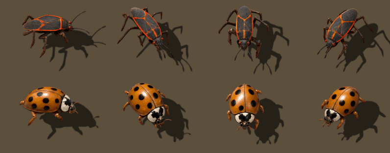

# Minnesota Bugs



Every fall, boxelder bugs and Asian lady beetles invade Minnesota by the thousand:
on the siding, in the window tracks, behind the curtains. This Factorio 2.0 mod
brings them to Nauvis. Small biters are boxelder bugs, medium biters are Asian lady
beetles, and you know what to do. Exterminate them all.

## What it changes

- Small biters are **boxelder bugs** (_Boisea trivittata_) and medium biters are
  **Asian lady beetles** (_Harmonia axyridis_), in all 16 directions of the run,
  attack, death and decay animations.
- Both creatures and their corpses get new icons.
- **Art only.** Health, speed, damage, AI, spawning and evolution are vanilla, and
  the mod has no runtime script, so you can add it to or remove it from an existing
  save. Big and behemoth biters, spitters and worms are untouched.

Requires Factorio 2.0. Works with or without Space Age.

## Install

In game: **Mods → Install**, search for _Minnesota Bugs_. Or download it from the
[mod portal](https://mods.factorio.com/mod/minnesota-bugs).

## How the art was made

The sprites were generated with OpenAI's `gpt-image-2.5-sunburst`, one request per
animation direction. Each request carries the vanilla biter's frames as a pose
guide, species photos, and a reference frame that keeps all 48 sheets of each
creature looking like the same bug. `tools/gen-art.py` then cuts the frames out
and aligns each one to the biter's hitbox. It computes the shadows from the
sprites' outlines, and the decay as a dissolve of the final death frame.
[CLAUDE.md](CLAUDE.md) has the details and what was learned along the way.

## Development

The per-frame source art in `art/` is in Git LFS, so install
[git-lfs](https://git-lfs.com) before cloning. The tools are
[uv](https://docs.astral.sh/uv/) scripts; the shell scripts also use `jq` and
`rg`, and assume Steam's install path on macOS (`FACTORIO_APP` overrides it).

```sh
git clone https://github.com/jonjaques/factorio-mn-bugs.git
cd factorio-mn-bugs
uv run tools/pack-art.py     # art/ -> graphics/, which is generated and not committed
ln -s "$PWD" ~/Library/Application\ Support/factorio/mods/minnesota-bugs
```

| Command                   | What it does                                                                    |
| ------------------------- | ------------------------------------------------------------------------------- |
| `tools/lab.sh`            | pack, then open Factorio in a lit test scenario with both creatures             |
| `tools/check.sh`          | headless: load the mod in a throwaway profile, spawn and kill                   |
| `tools/release.sh`        | build the mod portal zip in `build/release/`                                    |
| `uv run tools/gen-art.py` | regenerate art; needs `OPENAI_API_KEY` and your own photos in `reference/`      |

## License

[MIT](LICENSE). Factorio is © Wube Software Ltd., and this project is not
affiliated with Wube. The creature sprites were generated over the vanilla biter
animations, so they derive from Factorio's art. Wube's
[terms of service](https://factorio.com/terms-of-service) allow such derived art
in mods and reserve Wube's rights over it.
